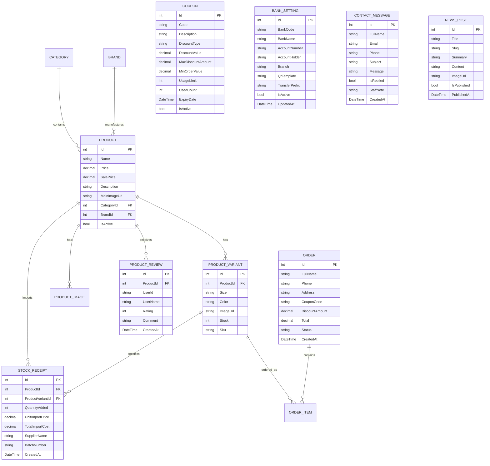

# Tiêu Đao Badminton - Hệ Thống Bán Lẻ, Đào Tạo & Dịch Vụ Cầu Lông Chuyên Nghiệp

[](https://dotnet.microsoft.com/download/dotnet/8.0)
[](https://docs.microsoft.com/aspnet/core)
[](https://docs.microsoft.com/ef/core)
[](https://www.microsoft.com/sql-server)
[](https://getbootstrap.com/)
[](https://icons.getbootstrap.com/)
[](https://ckeditor.com/)
[](https://learn.microsoft.com/en-us/dotnet/api/system.net.mail.smtpclient)

> **Tiêu Đao Badminton** là nền tảng thương mại điện tử và giải pháp quản lý chuỗi bán lẻ thiết bị cầu lông (vợt, giày, quần áo, phụ kiện), kết hợp học viện đào tạo cầu lông và dịch vụ căng cước chuẩn thi đấu quốc tế BWF. Hệ thống được xây dựng trên nền tảng **ASP.NET Core 8.0 MVC**, tích hợp đồng bộ kho hàng theo biến thể, ảnh preview tự động đổi theo màu sắc sản phẩm, áp dụng Mã giảm giá (Voucher) trực tiếp tại trang Thanh toán, Cấu hình Ngân hàng & mã VietQR động trong Admin, Bảng xếp hạng VĐV Việt Nam & Thế giới kèm hồ sơ lịch sử dùng vợt, Đăng ký khóa học trực tuyến gửi thẳng về Email Admin, Trợ lý tư vấn chọn vợt AI, Chatbot tra cứu tồn kho thực tế và phân hệ Quản trị Enterprise Admin Pro.

---

## Mục Lục

1. [Tổng Quan Dự Án](#tổng-quan-dự-án)
2. [Tính Năng Nổi Bật](#tính-năng-nổi-bật)
   - [Phân Hệ Khách Hàng (Storefront)](#1-phân-hệ-khách-hàng-storefront)
   - [Phân Hệ Quản Trị Viên (Enterprise Admin Pro)](#2-phân-hệ-quản-trị-viên-enterprise-admin-pro---admin)
3. [Công Nghệ & Thư Viện Sử Dụng](#công-nghệ--thư-viện-sử-dụng)
4. [Cấu Trúc Thư Mục Dự Án](#cấu-trúc-thư-mục-dự-án)
5. [Cơ Sở Dữ Liệu & Thực Thể (Database Schema)](#cơ-sở-dữ-liệu--thực-thể-database-schema)
6. [Hướng Dẫn Cài Đặt & Chạy Ứng Dụng](#hướng-dẫn-cài-đặt--chạy-ứng-dụng)
7. [Hướng Dẫn Chuyển Dự Án Sang Máy Khác](#hướng-dẫn-chuyển-dự-án-sang-máy-khác)
8. [Tài Khoản Quản Trị Mặc Định](#tài-khoản-quản-trị-mặc-định)
9. [Quy Trình Nghiệp Vụ Đặc Biệt](#quy-trình-nghiệp-vụ-đặc-biệt)
10. [Bản Quyền & Tác Giả](#bản-quyền--tác-giả)

---

## Tổng Quan Dự Án

Dự án giải quyết trọn vẹn bài toán đặc thù của hệ sinh thái kinh doanh và đào tạo cầu lông hiện đại:
- **Quản lý phân loại đa chiều (Màu sắc & Kích cỡ) kèm Ảnh Preview theo màu:** Mỗi cây vợt, đôi giày hoặc bộ trang phục có đồng thời thông số Màu sắc, Ảnh đại diện theo đúng màu (`ProductVariant.ImageUrl`) và Kích cỡ/Trọng lượng (`3U-G5`, `4U-G5`, size giày `38`–`44`, size áo `S`/`M`/`L`/`XL`/`XXL`).
- **Bảng xếp hạng VĐV Việt Nam & Thế giới gắn liền với Vũ khí thi đấu (`/Bang-Xep-Hang`):** Tra cứu thứ hạng BWF, điểm tích lũy, mức căng cước thực tế và toàn bộ lịch sử từng thời kỳ sử dụng vợt của các tuyển thủ Việt Nam (*Nguyễn Thùy Linh, Nguyễn Tiến Minh, Lê Đức Phát...*) và siêu sao thế giới (*Viktor Axelsen, Shi Yu Qi, An Se Young, Lin Dan, Lee Chong Wei...*), kết nối trực tiếp tới sản phẩm đang bán tại cửa hàng.
- **Học viện Đào tạo Cầu lông Cơ bản & Nâng cao (`/Dang-Ky-Khoa-Hoc`):** Cung cấp lộ trình học bài bản (Gói Cơ Bản & Gói Nâng Cao); khi học viên đăng ký sẽ tự động bắn Email HTML về hộp thư của Admin và lưu hồ sơ vào hệ thống quản trị.
- **Hệ thống Voucher Giảm Giá & Cổng VietQR Động theo Cấu hình Ngân hàng Admin:** Khách hàng áp dụng mã giảm giá theo số tiền cố định (`Fixed`) hoặc phần trăm (`Percent`) ngay trên trang Thanh toán qua AJAX; mã VietQR chuyển khoản tự động sinh theo tài khoản ngân hàng đang kích hoạt trong `/Admin/BankSettings`.
- **Tính toán lãi suất & đối chiếu tài chính thực tế:** Quản lý phiếu nhập kho riêng biệt, tính toán tỷ suất lợi nhuận gộp (**Profit Margin %**) và chênh lệch giá vốn (**Markup %**) dựa trên giá nhập và giá bán.
- **Giao diện chuẩn hóa 100% Bootstrap Icons:** Toàn bộ giao diện khách hàng và trang quản trị sử dụng hệ thống biểu tượng vector **Bootstrap Icons 1.11** sắc nét, hoàn toàn không sử dụng emoji.

---

## Tính Năng Nổi Bật

### 1. Phân Hệ Khách Hàng (Storefront)

* **Trang Chủ & Thanh Điều Hướng Tinh Gọn (`_Layout.cshtml` & `Home/Index.cshtml`):**
  - Thanh menu điều hướng 1 hàng hiện đại gồm Mega Menu Danh mục sản phẩm, Trang chủ, Vợt cầu lông, Giày thi đấu, Tư vấn vợt AI, Khóa học, BXH VĐV, Dịch vụ & Cẩm nang, Liên hệ.
  - Menu di động thiết kế dạng Lưới ứng dụng 2 cột (2-Column App Grid) gọn gàng.
  - Trưng bày sản phẩm bán chạy, thương hiệu chính hãng (*Yonex, Victor, Li-Ning, Mizuno, Kawasaki*) và tin tức cẩm nang mới nhất.

* **Bộ Lọc Danh Mục Chuyên Nghiệp (Product Catalog - `/Danh-Muc`):**
  - Cây danh mục đa cấp: Vợt cầu lông (*Tấn công Smash, Công thủ toàn diện, Tốc độ & Phản tạt, Trợ lực*), Giày cầu lông (*Đệm êm, Tốc độ, Chân bè Wide*), Trang phục thể thao (*Áo nam, Áo/Váy nữ, Quần short*).
  - Lọc kết hợp theo Thương hiệu, Khoảng giá, Từ khóa và Sắp xếp linh hoạt.

* **Trang Chi Tiết Sản Phẩm Đột Phá (`/Products/Detail/{id}` hoặc `/San-Pham/{id}`):**
  - **Chuyển đổi Ảnh Preview theo Màu sắc:** Khi khách hàng chọn một màu sắc (hoặc bấm vào ảnh thu nhỏ của màu), ảnh lớn sẽ tự động chuyển sang hình ảnh sản phẩm tương ứng với màu đó.
  - **Tách biệt Màu sắc & Kích cỡ (Chuẩn Unicode NFC):** Khách hàng chọn Màu sắc để lọc các Size thực sự có trong kho, hiển thị tức thì số lượng tồn kho (`Kho còn X`) và mã SKU.
  - **Hệ thống Đánh giá & Xếp hạng (Reviews & Ratings):** Cho phép khách hàng đã đăng nhập gửi đánh giá 1–5 sao, thống kê điểm trung bình và biểu đồ phân bổ sao.

* **Bảng Xếp Hạng VĐV Việt Nam & Thế Giới - Hồ Sơ Vợt Thi Đấu (`/Bang-Xep-Hang`):**
  - Chia thành 3 bảng xếp hạng chuyên sâu:
    1. **BXH Đội Tuyển Quốc Gia Việt Nam:** *Nguyễn Thùy Linh, Nguyễn Tiến Minh, Lê Đức Phát, Nguyễn Hải Đăng, Vũ Thị Trang, Phạm Văn Hải & Thân Vân Anh*.
    2. **BXH BWF Thế Giới Hiện Tại:** *Shi Yu Qi, Viktor Axelsen, Anders Antonsen, Kunlavut Vitidsarn, Lee Zii Jia, Loh Kean Yew, An Se Young, Chen Yu Fei, Tai Tzu Ying, Lee Yang & Wang Chi-Lin*.
    3. **BXH Huyền Thoại Thế Giới (Hall of Fame):** *Lin Dan, Lee Chong Wei, Kento Momota, Chen Long, Carolina Marin, Hendra Setiawan & Mohammad Ahsan*.
  - Hiển thị rõ **Vợt chủ lực hiện tại**, **Loại cước & Số kg căng thực tế**, **Giày thi đấu**, và **Timeline lịch sử từng đánh những cây vợt nào qua các giai đoạn**.
  - Tự động ánh xạ dòng vợt của VĐV sang sản phẩm trong Database để hiển thị giá bán và nút dẫn thẳng sang trang mua hàng `/Products/Detail/{id}`.

* **Đăng Ký Khóa Học Cầu Lông Cơ Bản & Nâng Cao (`/Dang-Ky-Khoa-Hoc`):**
  - Thiết kế 2 gói đào tạo rõ ràng:
    - **Gói Cơ Bản (Basic - 1.200.000đ / 12 buổi):** Dành cho người mới bắt đầu, chuẩn hóa cách cầm vợt, bộ pháp di chuyển 6 góc sân, phông cầu, giao cầu và bỏ nhỏ (Tặng 02 quấn cán + miễn phí mượn vợt tập).
    - **Gói Nâng Cao (Advanced - 2.200.000đ / 12 buổi):** Chuyên sâu kỹ thuật Jump Smash, phản tạt nhanh ngang lưới, trái tay cuối sân và chiến thuật Đánh Đôi xoay vòng (Tặng 01 lần căng cước máy điện tử 4 nút miễn phí + phân tích video Slow-motion 1:1).
  - Tích hợp bảng so sánh chương trình học và biểu mẫu đăng ký tương tác trực tiếp.
  - **Gửi Email tự động về Admin:** Ngay khi học viên hoàn tất đăng ký, hệ thống tự động gửi Email HTML chi tiết về địa chỉ `AdminEmail` (kèm `ReplyTo` tới email học viên), gửi email xác nhận cho học viên và lưu vào hộp thư quản trị `/Admin/Contacts`.

* **Trợ Lý Tư Vấn Chọn Vợt AI (`/Tu-Van-Chon-Vot`) & Dịch Vụ Căng Cước 4 Nút (`/Dich-Vu-Cang-Cuoc`):**
  - Phân tích lối chơi, lực cổ tay và ngân sách để chấm điểm độ tương thích và gợi ý mẫu vợt phù hợp nhất.
  - Bảng giá các dòng cước chính hãng (*Yonex BG65, BG65Ti, BG80 Power, Nanogy 98, Aerobite, Li-Ning No.1, Kizuna Z63X*) và dịch vụ Spa/Hàn vợt carbon.

* **Widget Tiện Ích Nổi 3-Trong-1 & Chatbot Tư Vấn Tồn Kho (`/api/Chatbot/Ask`):**
  - Tích hợp nút Lên đầu trang, nút Gọi Hotline và cửa sổ Chatbot trực tuyến.
  - Chatbot truy vấn trực tiếp cơ sở dữ liệu SQL Server để báo giá khuyến mãi, màu sắc/size và số lượng tồn kho thực tế.

* **Giỏ Hàng, Mã Giảm Giá (Voucher), VietQR Động & Thanh Toán SMTP Email (`/Checkout`):**
  - **Áp dụng Mã giảm giá / Voucher tức thì (AJAX - `/Checkout/CheckCoupon`):** Cho phép khách hàng nhập mã giảm giá hoặc bấm chọn trực tiếp từ danh sách Voucher đang có sẵn (`TIEUDAO50`, `YONEX10`, `PRO200K`, `VIP300K`), tự động kiểm tra giá trị đơn tối thiểu, hạn sử dụng, số lượt còn lại và khấu trừ trực tiếp vào tổng thanh toán.
  - **Chuyển khoản Ngân hàng VietQR Động:** Hiển thị thông tin tài khoản thụ hưởng ngay khi chọn phương thức chuyển khoản và tự động sinh mã QR chuẩn Napas (`img.vietqr.io`) theo đúng số tiền sau giảm giá cùng cấu hình ngân hàng mà Admin thiết lập.
  - **Địa chỉ hành chính 2 cấp sau sáp nhập:** Tích hợp API hành chính Việt Nam mới (`https://provinces.open-api.vn/api/v2`) gồm 2 cấp: **Tỉnh / Thành phố** -> **Phường / Xã / Đặc khu**.
  - Tự động trừ tồn kho biến thể, cập nhật lượt dùng Voucher và gửi Email HTML xác nhận đơn hàng (kèm thông tin giảm giá) cho cả Khách hàng và Admin.

---

### 2. Phân Hệ Quản Trị Viên (Enterprise Admin Pro - `/Admin`)

* **Giao Diện Quản Trị Enterprise SaaS (`wwwroot/css/admin.css` & `_AdminLayout.cshtml`):**
  - **Sidebar Dark Obsidian:** Tích hợp bộ đếm trực tiếp (Live Badges) cho *Đơn hàng chờ xử lý*, *Sản phẩm sắp hết/hết hàng*, và *Tin nhắn/Đăng ký khóa học chưa phản hồi*, hỗ trợ đóng/mở ngăn kéo (Drawer) trên thiết bị di động.
  - **Topbar Glassmorphism:** Tích hợp thanh tìm kiếm nhanh có phím tắt `Ctrl + K`, menu **Tạo nhanh (Quick Create)** và chuông thông báo thời gian thực.

* **Bảng Điều Khiển Trung Tâm (`/Admin/Home`):**
  - **Executive Hero Banner** & **Dải đối chiếu tài chính (`.admin-profit-strip`):** So sánh trực quan Doanh thu thực thu, Giá vốn xuất kho, Lợi nhuận ròng và Biên lợi nhuận (`%`).
  - Biểu đồ kết hợp Doanh thu & Số lượng đơn hàng 6 tháng gần nhất và biểu đồ Thị phần thương hiệu (Chart.js).
  - Bảng đơn hàng mới kèm avatar chữ cái đầu của khách hàng và bảng xếp hạng Top 5 sản phẩm bán chạy (`#1`, `#2`, `#3`).

* **Quản Lý Sản Phẩm, Kho Hàng & Ảnh Theo Màu (`/Admin/Products` & `/Admin/StockReceipts`):**
  - Quản lý danh sách sản phẩm, nhập nhanh tồn kho trực tiếp qua Modal hoặc lập Phiếu nhập kho đầy đủ nguồn gốc/giá vốn.
  - Cho phép tải ảnh hoặc gắn URL ảnh riêng cho từng biến thể màu sắc (`VariantImageUrls`).
  - Báo cáo đối chiếu lãi suất bán & nhập (`/Admin/StockReceipts/Report`) tính toán tự động **Profit Margin (%)** và **Markup (%)**:
    $$\text{Profit Margin (\%)} = \frac{\text{Giá bán} - \text{Giá nhập}}{\text{Giá bán}} \times 100\%$$
    $$\text{Markup (\%)} = \frac{\text{Giá bán} - \text{Giá nhập}}{\text{Giá nhập}} \times 100\%$$

* **Quản Lý Mã Giảm Giá / Voucher (`/Admin/Coupons`):**
  - Tạo mới, chỉnh sửa, tạm khóa/kích hoạt hoặc xóa mã giảm giá.
  - Hỗ trợ 2 hình thức khuyến mãi: **Giảm tiền mặt cố định (`Fixed` - VNĐ)** và **Giảm theo phần trăm (`Percent` - %)** kèm trần giảm tối đa (`MaxDiscountAmount`), điều kiện đơn hàng tối thiểu (`MinOrderValue`), giới hạn tổng lượt dùng (`UsageLimit`) và ngày hết hạn (`ExpiryDate`).

* **Cấu Hình Ngân Hàng & Cổng VietQR (`/Admin/BankSettings`):**
  - Quản lý danh sách tài khoản ngân hàng nhận thanh toán của cửa hàng (hỗ trợ đầy đủ ngân hàng Napas/VietQR: `MB`, `VCB`, `TCB`, `ACB`, `BIDV`, `CTG`, `VPB`, `TPB`, `STB`, `VIB`, `MSB`, `SHB`, `HDB`, `OCB`, `VBA`).
  - Cho phép tùy chỉnh Số tài khoản, Chủ tài khoản, Chi nhánh, Giao diện khung VietQR (`compact2`, `compact`, `print`, `qr_only`), Tiền tố nội dung chuyển khoản (`DH`, `TD`...) và **Xem trước mã VietQR trực tiếp (Live Preview)** ngay khi nhập liệu.
  - Chuyển đổi tài khoản ngân hàng nhận tiền mặc định chỉ với 1 cú nhấp chuột; tài khoản đang kích hoạt (`IsActive`) sẽ tự động áp dụng ngay trên trang Thanh toán và Đặt hàng thành công của khách hàng.

* **Quản Lý Đơn Hàng, Tin Tức (CKEditor 5), Hộp Thư Liên Hệ & Tài Khoản:**
  - Duyệt đơn hàng theo quy trình chuẩn (*Pending -> Confirmed -> Shipping -> Done / Cancelled*), hiển thị rõ mã Voucher và số tiền giảm giá trên từng đơn hàng, tự động hoàn trả tồn kho nếu hủy đơn.
  - Soạn thảo bài viết cẩm nang với **CKEditor 5 Classic** hỗ trợ dán/kéo thả ảnh trực tiếp.
  - Quản lý hộp thư liên hệ & hồ sơ đăng ký khóa học tại `/Admin/Contacts`.
  - Quản lý tài khoản, khóa/mở khóa và cấp lại mật khẩu khẩn cấp tại `/Admin/Accounts`.

---

## Công Nghệ & Thư Viện Sử Dụng

| Hạng mục | Công nghệ / Thư viện | Ghi chú |
| :--- | :--- | :--- |
| **Framework nền tảng** | ASP.NET Core 8.0 MVC | C# .NET 8.0 (LTS) |
| **ORM & Database** | Entity Framework Core 8.0 | Code-First Migrations, SQL Server / LocalDB |
| **Bảo mật & Xác thực** | ASP.NET Core Identity | Phân quyền Role-based (`Admin`, `Staff`, `Customer`) |
| **Giao diện & Icon** | Razor Views + Bootstrap 5.3 + Bootstrap Icons 1.11 | 100% Vector Icons, Enterprise Admin Pro UI |
| **Biểu đồ & Trực quan hóa** | Chart.js 4.4 | Biểu đồ doanh thu kép & thị phần thương hiệu |
| **Trình soạn thảo WYSIWYG** | CKEditor 5 Classic (Tiếng Việt) | Tích hợp API tải ảnh trực tiếp lên máy chủ |
| **Thanh toán & Khuyến mãi** | VietQR Dynamic API (`img.vietqr.io`) + AJAX Coupon Engine | Cấu hình ngân hàng trong Admin & áp mã giảm giá thời gian thực |
| **Dịch vụ Email** | `System.Net.Mail.SmtpClient` | Gửi email HTML cho Đơn hàng mới & Đăng ký khóa học |
| **API Địa chỉ hành chính** | Provinces Open API v2 (`provinces.open-api.vn/api/v2`) | Địa chỉ Việt Nam 2 cấp sau sáp nhập (Tỉnh/TP -> Phường/Xã) |

---

## Cấu Trúc Thư Mục Dự Án

```plaintext
tieudaobadminton/
├── Areas/
│   └── Admin/                              # Phân hệ Quản trị (Enterprise Admin Pro)
│       ├── Controllers/                    # Controllers quản trị
│       │   ├── AccountsController.cs       # Quản lý tài khoản & phân quyền
│       │   ├── BankSettingsController.cs   # Cấu hình ngân hàng nhận tiền & VietQR động
│       │   ├── BrandsController.cs         # Quản lý thương hiệu
│       │   ├── CategoriesController.cs     # Quản lý danh mục
│       │   ├── ContactsController.cs       # Quản lý hộp thư liên hệ & đăng ký khóa học
│       │   ├── CouponsController.cs        # Quản lý mã giảm giá / Voucher
│       │   ├── HomeController.cs           # Dashboard trung tâm & thống kê tài chính
│       │   ├── NewsController.cs           # Quản lý bài viết cẩm nang (CKEditor 5)
│       │   ├── OrdersController.cs         # Quản lý đơn hàng & in phiếu giao hàng
│       │   ├── ProductsController.cs       # Quản lý sản phẩm, biến thể & ảnh theo màu
│       │   └── StockReceiptsController.cs  # Quản lý phiếu nhập kho & báo cáo lãi suất (%)
│       ├── ViewModels/                     # ViewModels thống kê Dashboard & Quản trị
│       └── Views/                          # Giao diện Admin (Home, Orders, Products, Coupons, BankSettings...)
├── Controllers/                            # Controllers phân hệ Khách hàng (Storefront)
│   ├── AccountController.cs                # Đăng ký, đăng nhập, đơn hàng cá nhân
│   ├── CartController.cs                   # Giỏ hàng Session
│   ├── CatalogController.cs                # Danh mục sản phẩm & bộ lọc đa tiêu chí (/Danh-Muc)
│   ├── ChatbotController.cs                # API Chatbot tra cứu sản phẩm & tồn kho (/api/Chatbot/Ask)
│   ├── CheckoutController.cs               # Đặt hàng, kiểm tra mã giảm giá (/Checkout/CheckCoupon), VietQR & gửi email
│   ├── ContactController.cs                # Trang liên hệ & hỗ trợ (/Lien-He)
│   ├── CourseController.cs                 # Trang đăng ký khóa học Cơ bản & Nâng cao (/Dang-Ky-Khoa-Hoc)
│   ├── GuideController.cs                  # Hướng dẫn chọn size vợt, giày & quần áo (/Huong-Dan-Size)
│   ├── HomeController.cs                   # Trang chủ
│   ├── NewsController.cs                   # Tạp chí cẩm nang cầu lông (/News)
│   ├── OrderTrackingController.cs          # Tra cứu tiến độ đơn hàng (/Tra-Cuu-Don-Hang)
│   ├── ProductsController.cs               # Chi tiết sản phẩm (/Products/Detail/{id} & /San-Pham/{id})
│   ├── RacketAdvisorController.cs          # Trợ lý tư vấn chọn vợt AI (/Tu-Van-Chon-Vot)
│   ├── RankingController.cs                # Bảng xếp hạng VĐV Việt Nam & Thế giới + Hồ sơ vợt (/Bang-Xep-Hang)
│   ├── ServicesController.cs               # Dịch vụ căng cước máy điện tử 4 nút (/Dich-Vu-Cang-Cuoc)
│   └── WishlistController.cs               # Danh sách sản phẩm yêu thích (/Yeu-Thich)
├── Data/                                   # Cấu hình Database & Tự động khởi tạo dữ liệu mẫu
│   ├── ApplicationDbContext.cs             # DbContext chính của hệ thống
│   ├── DbSeeder.cs                         # Seed sản phẩm, biến thể màu/ảnh, mã giảm giá, cấu hình ngân hàng, đánh giá mẫu
│   └── IdentitySeeder.cs                   # Seed tài khoản Admin & phân quyền mặc định
├── Helpers/                                # Các dịch vụ tiện ích
│   ├── OrderNotificationEmailService.cs    # Dịch vụ gửi Email SMTP cho Đơn hàng mới & Đăng ký khóa học
│   └── SessionExtensions.cs                # Tiện ích lưu/đọc Object JSON trong Session
├── Models/                                 # Thực thể cơ sở dữ liệu (Product, ProductVariant, Order, Coupon, BankSetting...)
├── ViewModels/                             # ViewModels (CourseRegistrationVM, PlayerRankingVM, CheckoutVM, ContactVM...)
├── Views/                                  # Giao diện khách hàng (Razor Views)
│   ├── Checkout/Index.cshtml               # Giao diện Thanh toán tích hợp chọn Voucher & hiển thị ngân hàng VietQR
│   ├── Checkout/Success.cshtml             # Giao diện Đặt hàng thành công sinh mã VietQR động theo cấu hình Admin
│   ├── Course/Index.cshtml                 # Giao diện Đăng ký khóa học (Gói Cơ bản & Nâng cao)
│   ├── Ranking/Index.cshtml                # Giao diện Bảng xếp hạng VĐV & Timeline lịch sử dùng vợt
│   ├── Products/Detail.cshtml              # Chi tiết sản phẩm tự động đổi ảnh preview theo màu
│   └── Shared/_Layout.cshtml               # Layout chính với thanh điều hướng tinh gọn & Chatbot Widget
├── wwwroot/                                # Tài nguyên tĩnh (css/site.css, css/admin.css, img, uploads)
├── appsettings.json                        # Cấu hình chuỗi kết nối SQL Server & SMTP Email
├── Program.cs                              # Cấu hình Dependency Injection, Routing & Auto-Seeding
└── tieudaobadminton.csproj                 # Tệp cấu hình dự án .NET 8.0
```

---

## Cơ Sở Dữ Liệu & Thực Thể (Database Schema)



---

## Hướng Dẫn Cài Đặt & Chạy Ứng Dụng

### 1. Yêu Cầu Môi Trường (Prerequisites)
- [.NET 8.0 SDK](https://dotnet.microsoft.com/download/dotnet/8.0) trở lên.
- **SQL Server** (SQL Server LocalDB đi kèm Visual Studio, SQL Server Express, hoặc SQL Server Developer).

### 2. Cấu Hình `appsettings.json`
Mở tệp `appsettings.json` tại thư mục gốc của dự án để kiểm tra chuỗi kết nối Database và cấu hình SMTP Email nhận thông báo đơn hàng / đăng ký khóa học:
```json
{
  "ConnectionStrings": {
    "DefaultConnection": "Server=(localdb)\\MSSQLLocalDB;Database=BadmintonShop;Trusted_Connection=True;TrustServerCertificate=True;"
  },
  "SmtpSettings": {
    "Host": "smtp.gmail.com",
    "Port": 587,
    "EnableSsl": true,
    "SenderName": "Tiêu Đao Badminton Pro",
    "SenderEmail": "your-email@gmail.com",
    "AppPassword": "your-16-char-app-password",
    "AdminEmail": "admin@shop.com"
  }
}
```
> **Lưu ý về SMTP Gmail:**
> - Để gửi email thực tế về hộp thư `AdminEmail` khi có **Đơn đặt hàng mới** hoặc **Học viên đăng ký khóa học mới**, hãy bật xác minh 2 bước (2-Step Verification) trong tài khoản Google và tạo **Mật khẩu ứng dụng (App Password)** gồm 16 ký tự để điền vào `"AppPassword"`, đồng thời điền địa chỉ email của bạn vào `"SenderEmail"` và `"AdminEmail"`.
> - Nếu chưa cấu hình SMTP thực tế, toàn bộ đơn hàng và hồ sơ đăng ký khóa học vẫn được lưu an toàn vào cơ sở dữ liệu và hiển thị trực tiếp trên chuông thông báo cũng như mục `/Admin/Orders` và `/Admin/Contacts`.

### 3. Cập Nhật Cơ Sở Dữ Liệu & Khởi Chạy
Mở Terminal / PowerShell tại thư mục chứa dự án và chạy:
```powershell
dotnet restore
dotnet ef database update
dotnet run
```
*(Hệ thống đã được lập trình tự động khởi tạo bảng và Seed đầy đủ dữ liệu sản phẩm, biến thể màu/ảnh, bài viết, đơn hàng mẫu và tài khoản Admin ngay trong lần chạy đầu tiên).*

Sau khi khởi động, truy cập các phân hệ chính:
- **Trang chủ Khách hàng:** `https://localhost:7085`
- **Danh mục Sản phẩm:** `https://localhost:7085/Danh-Muc`
- **Thanh toán & Áp dụng Voucher:** `https://localhost:7085/Checkout`
- **Đăng ký Khóa học (Cơ bản & Nâng cao):** `https://localhost:7085/Dang-Ky-Khoa-Hoc`
- **Bảng xếp hạng VĐV & Hồ sơ Vợt thi đấu:** `https://localhost:7085/Bang-Xep-Hang`
- **Tư vấn chọn vợt thông minh (AI):** `https://localhost:7085/Tu-Van-Chon-Vot`
- **Trang Quản trị Enterprise Admin Pro:** `https://localhost:7085/Admin`
- **Quản lý Mã giảm giá (Voucher):** `https://localhost:7085/Admin/Coupons`
- **Cấu hình Ngân hàng & VietQR:** `https://localhost:7085/Admin/BankSettings`

---

## Hướng Dẫn Chuyển Dự Án Sang Máy Khác

Khi sao chép hoặc clone dự án sang một máy tính mới, chỉ cần thực hiện 4 bước:

1. **Cài đặt công cụ trên máy mới:** Cài **.NET 8.0 SDK** và **SQL Server (LocalDB hoặc SQL Express)**.
2. **Sao chép mã nguồn kèm thư mục ảnh:** Đảm bảo giữ nguyên thư mục `wwwroot/img/` và `wwwroot/uploads/` (có thể xóa `bin/` và `obj/` trước khi nén).
3. **Kiểm tra tên Server SQL trong `appsettings.json`:**
   - Dùng LocalDB: giữ nguyên `Server=(localdb)\\MSSQLLocalDB`.
   - Dùng SQL Express: đổi thành `Server=.\\SQLEXPRESS`.
4. **Chạy lệnh khởi động:**
   ```powershell
   dotnet restore
   dotnet run
   ```
   Ứng dụng sẽ tự động tạo Database `BadmintonShop`, khởi tạo toàn bộ bảng, chuẩn hóa biến thể màu sắc/ảnh sản phẩm và nạp sẵn tài khoản Admin.

---

## Tài Khoản Quản Trị Mặc Định

| Vai trò (Role) | Tài khoản (Email) | Mật khẩu (Password) | Quyền hạn |
| :--- | :--- | :--- | :--- |
| **Quản trị viên (Admin)** | `admin@shop.com` | `Admin@12345` | Toàn quyền quản trị Dashboard, đơn hàng, kho hàng, phiếu nhập, bài viết, liên hệ & khóa học, tài khoản |

---

## Quy Trình Nghiệp Vụ Đặc Biệt

### 1. Cơ Chế Lọc Phân Loại Kho & Đổi Ảnh Preview Theo Màu (`ProductVariant.ImageUrl`)
- Dữ liệu màu sắc, đường dẫn ảnh theo màu (`ImageUrl`) và kích cỡ được quản lý trong bảng `ProductVariants`.
- Khi khách hàng chọn một màu sắc tại trang chi tiết sản phẩm (`/Products/Detail/{id}` hoặc `/San-Pham/{id}`), hệ thống tự động đổi ảnh preview chính sang hình ảnh của màu đó và lọc danh sách kích cỡ kèm số lượng tồn kho tương ứng.

### 2. Luồng Đăng Ký Khóa Học & Thông Báo Kép Về Admin (`/Dang-Ky-Khoa-Hoc`)
- Học viên chọn giữa **Gói Cơ Bản (1.200.000đ)** và **Gói Nâng Cao (2.200.000đ)**, điền thông tin cá nhân, độ tuổi, ca học và cơ sở sân tập.
- Hệ thống lưu hồ sơ vào bảng `ContactMessages` (hiển thị ngay trên bộ đếm Sidebar Admin `/Admin/Contacts`) đồng thời gọi `OrderNotificationEmailService.SendCourseRegistrationNotificationAsync` để gửi Email HTML chi tiết về hộp thư của Admin và gửi email xác nhận mã hồ sơ `#KHxxxx` cho học viên.

### 3. Bảng Xếp Hạng VĐV & Ánh Xạ Sản Phẩm Tự Động (`/Bang-Xep-Hang`)
- `RankingController` tổng hợp dữ liệu 16 VĐV và cặp đôi hàng đầu Việt Nam, Thế giới và Huyền thoại BWF cùng lịch sử các đời vợt từng sử dụng.
- Hệ thống tự động đối chiếu tên vợt của từng VĐV với bảng `Products` trong cơ sở dữ liệu để hiển thị giá bán thực tế và tạo liên kết mua hàng trực tiếp tới đúng mẫu vợt đó tại cửa hàng.

### 4. Cơ Chế Áp Dụng Mã Giảm Giá (Voucher) & Cổng VietQR Động (`/Checkout`, `/Admin/Coupons`, `/Admin/BankSettings`)
- **Mã giảm giá mẫu được khởi tạo tự động:**
  - `TIEUDAO50`: Giảm 50.000đ cho đơn từ 500.000đ.
  - `YONEX10`: Giảm 10% (tối đa 300.000đ) cho đơn từ 1.500.000đ.
  - `PRO200K`: Giảm 200.000đ cho đơn từ 3.000.000đ.
  - `VIP300K`: Giảm 300.000đ cho đơn từ 5.000.000đ.
- Khi khách hàng chọn hoặc nhập mã tại `/Checkout`, hệ thống gọi `/Checkout/CheckCoupon` để kiểm tra điều kiện và cập nhật ngay số tiền được giảm. Khi đặt hàng thành công, `UsedCount` của mã sẽ tự động tăng lên và lưu vết `CouponCode` + `DiscountAmount` vào đơn hàng.
- Khi khách hàng chọn **Chuyển khoản Ngân hàng (VietQR)**, hệ thống tự động lấy tài khoản ngân hàng đang được kích hoạt (`IsActive = true`) trong `/Admin/BankSettings` để sinh mã QR động (`https://img.vietqr.io/image/{BankCode}-{AccountNumber}-{QrTemplate}.png?amount=...&addInfo=...`) khớp chính xác với số tiền thanh toán sau giảm giá.

---

## Bản Quyền & Tác Giả

- **Dự Án:** Đồ Án Môn Học - Hệ Thống Bán Lẻ, Đào Tạo & Quản Lý Dụng Cụ Cầu Lông Tiêu Đao
- **Nền tảng phát triển:** ASP.NET Core 8.0 MVC
- **Năm thực hiện:** 2026
