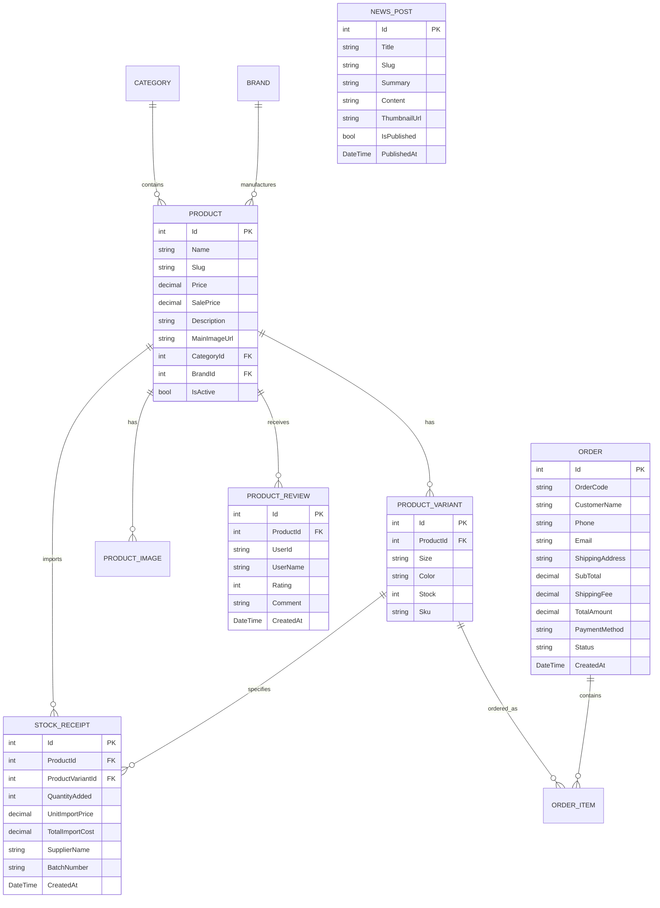

# 🏸 Tiêu Đao Badminton - Hệ Thống Bán Lẻ & Dịch Vụ Cầu Lông Chuyên Nghiệp

[](https://dotnet.microsoft.com/download/dotnet/8.0)
[](https://docs.microsoft.com/aspnet/core)
[](https://docs.microsoft.com/ef/core)
[](https://www.microsoft.com/sql-server)
[](https://getbootstrap.com/)
[](https://ckeditor.com/)
[](https://learn.microsoft.com/en-us/dotnet/api/system.net.mail.smtpclient)

> **Tiêu Đao Badminton** là nền tảng thương mại điện tử và giải pháp quản lý chuỗi bán lẻ thiết bị thể thao (vợt, giày, quần áo, phụ kiện) kết hợp dịch vụ căng cước cầu lông chuẩn thi đấu quốc tế. Hệ thống được xây dựng trên nền tảng **ASP.NET Core 8.0 MVC**, tích hợp đồng bộ kho hàng theo biến thể, tư vấn chọn vợt thông minh, Chatbot tra cứu tồn kho thực tế, địa chỉ hành chính Việt Nam sau sáp nhập 2 cấp, thông báo đơn hàng qua SMTP Email và báo cáo lợi nhuận - lãi suất thực tế.

---

## 📑 Mục Lục

1. [Tổng Quan Dự Án](#-tổng-quan-dự-án)
2. [Tính Năng Nổi Bật](#-tính-năng-nổi-bật)
   - [Phân Hệ Khách Hàng (Storefront)](#1-phân-hệ-khách-hàng-storefront)
   - [Phân Hệ Quản Trị Viên (Admin Portal)](#2-phân-hệ-quản-trị-viên-admin-portal)
3. [Công Nghệ & Thư Viện Sử Dụng](#-công-nghệ--thư-viện-sử-dụng)
4. [Cấu Trúc Thư Mục Dự Án](#-cấu-trúc-thư-mục-dự-án)
5. [Cơ Sở Dữ Liệu & Thực Thể (Database Schema)](#-cơ-sở-dữ-liệu--thực-thể-database-schema)
6. [Hướng Dẫn Cài Đặt & Chạy Ứng Dụng](#-hướng-dẫn-cài-đặt--chạy-ứng-dụng)
7. [Hướng Dẫn Chuyển Dự Án Sang Máy Khác](#-hướng-dẫn-chuyển-dự-án-sang-máy-khác)
8. [Tài Khoản Quản Trị Mặc Định](#-tài-khoản-quản-trị-mặc-định)
9. [Quy Trình Nghiệp Vụ Đặc Biệt](#-quy-trình-nghiệp-vụ-đặc-biệt)
10. [Bản Quyền & Tác Giả](#-bản-quyền--tác-giả)

---

## 🚀 Tổng Quan Dự Án

Dự án giải quyết trọn vẹn bài toán đặc thù của ngành kinh doanh dụng cụ cầu lông:
- **Quản lý phân loại đa chiều (Màu sắc & Kích cỡ):** Một cây vợt hoặc đôi giày có đồng thời thông số Màu sắc và Kích cỡ/Trọng lượng (3U-G5, 4U-G5, size giày từ 38 đến 44, size áo S/M/L/XL/XXL).
- **Dịch vụ căng cước đi kèm:** Khách mua vợt thường yêu cầu căng cước máy điện tử với mức cân (kg) và kiểu đan 4 nút chuẩn Yonex.
- **Tính toán lãi suất thực tế:** Quản lý phiếu nhập kho riêng biệt, tính toán tỷ suất lợi nhuận gộp (**Profit Margin %**) và chênh lệch giá vốn (**Markup %**) dựa trên giá nhập và giá bán.
- **Tư vấn & Chăm sóc khách hàng 24/7:** Kết hợp công cụ trắc nghiệm chọn vợt AI và Widget nổi tích hợp Chatbot tra cứu tồn kho trực tiếp từ cơ sở dữ liệu.
- **Trải nghiệm đặt hàng hiện đại:** Hỗ trợ chọn địa chỉ hành chính Việt Nam mới nhất sau sáp nhập (2 cấp: Tỉnh/Thành phố ➔ Phường/Xã/Đặc khu) và tự động gửi thông báo đơn hàng qua SMTP Email cho cả Khách hàng lẫn Admin.

---

## ✨ Tính Năng Nổi Bật

### 1. Phân Hệ Khách Hàng (Storefront)

* **Trang Chủ Hiện Đại (Home Page):**
  - Banner Hero chuyển động, danh mục truy cập nhanh.
  - Khối Flash Sale, sản phẩm bán chạy, sản phẩm mới nhất.
  - Trưng bày thương hiệu chính hãng: *Yonex, Victor, Li-Ning, Mizuno, Kumpoo, Kawasaki...*
  - Giới thiệu dịch vụ sân cầu, đan cước lấy ngay 15 phút.
  - Cẩm nang & tin tức kinh nghiệm mới nhất.

* **Bộ Lọc Danh Mục Chuyên Nghiệp (Product Catalog - `/Danh-Muc`):**
  - Lọc đa tiêu chí: Theo Danh mục, Thương hiệu, Khoảng giá, Tình trạng còn hàng.
  - Sắp xếp linh hoạt: Bán chạy, Giá tăng/giảm, Mới nhất, Thứ tự chữ cái.
  - Phân trang (Pagination) mượt mà.

* **Trang Chi Tiết Sản Phẩm Đột Phá (Product Detail - `/Products/Detail/{id}`):**
  - **Tách biệt Màu sắc & Kích cỡ (Chuẩn Unicode NFC):** Khách hàng chủ động chọn Màu sắc để mở khóa các Size tương ứng có trong kho.
  - **Liên kết kho hàng thực tế:** Hiển thị tức thì số lượng tồn kho từng màu (`Kho còn X`) và từng size (`Còn Y chiếc`), gắn mã SKU kho hàng tự động.
  - **Dịch vụ căng cước tích hợp:** Tùy chọn mức căng cước (10.5kg, 11kg, 11.5kg, 12kg...) miễn phí đan máy điện tử 4 nút chuẩn thi đấu.
  - **Hệ thống đánh giá & Review:** Đăng nhập để đánh giá sao (1-5 ⭐) và để lại nhận xét, có tổng hợp điểm trung bình và tỷ lệ phân bổ sao.
  - **Modal bảng quy đổi Size:** Hướng dẫn chọn size vợt (3U/4U/5U), size giày chuẩn mm, size trang phục thể thao.

* **Widget Tiện Ích Nổi 3-Trong-1 & Chatbot Tư Vấn Kho Hàng (`_Layout.cshtml` & `/api/Chatbot/Ask`):**
  - **Nút Quay về đầu trang (Back to Top):** Tự động xuất hiện khi cuộn trang và cuộn mượt về đầu trang.
  - **Nút Gọi Tư Vấn (`tel:0900000000`):** Hiệu ứng vòng sóng (Pulse Ring) kết nối nhanh tới Hotline kỹ thuật viên.
  - **Chatbot Tư Vấn Thông Minh:**
    - Tích hợp các thẻ câu hỏi nhanh (Quick Reply Chips): *Tư vấn chọn vợt, Giá căng cước, Chọn size giày, Tra cứu đơn, Bảo hành & Freeship, Liên hệ cửa hàng*.
    - Kết nối trực tiếp tới `ChatbotController` (`/api/Chatbot/Ask`) để tìm kiếm sản phẩm, giá khuyến mãi, màu sắc/size và số lượng tồn kho thực tế trong SQL Server kèm đường dẫn xem chi tiết sản phẩm.

* **Trợ Lý Tư Vấn Chọn Vợt Thông Minh (Racket Advisor - `/Tu-Van-Chon-Vot`):**
  - Trắc nghiệm theo 3 tiêu chí cốt lõi: *Lối đánh*, *Lực cổ tay*, và *Ngân sách dự kiến*.
  - Thuật toán tự động chấm điểm và gợi ý Top 4 cây vợt tối ưu kèm lời khuyên chuyên gia.

* **Tạp Chí Cẩm Nang & Kinh Nghiệm Cầu Lông (News Magazine - `/Cam-Nang`):**
  - Giao diện báo chí hiện đại với các phân loại: Vợt, Giày, Kỹ thuật Smash, Căng cước.
  - **Mục lục bài viết tự động (TOC):** Tự động phát hiện các tiêu đề `H2`, `H3` để tạo mục lục nội dung bấm nhảy mượt mà.
  - **Tiện ích đọc bài chuyên nghiệp:** Thanh tiến trình cuộn trang (Progress Bar), công cụ tăng/giảm cỡ chữ (A-, A, A+), nút in bài viết, sao chép link, chia sẻ qua Facebook & Zalo.

* **Giỏ Hàng, Địa Chỉ Hành Chính Sau Sáp Nhập & Thanh Toán (Cart & Checkout):**
  - Quản lý giỏ hàng lưu Session, tự động tính phí vận chuyển (Freeship cho đơn từ 500.000đ).
  - **Chọn Địa Chỉ Hành Chính Việt Nam Mới (Sau sáp nhập 2 cấp):**
    - Tích hợp API hành chính v2 (`https://provinces.open-api.vn/api/v2`) với 2 ô `<select><option>`: **Tỉnh / Thành phố (34 tỉnh/thành sau sáp nhập)** ➔ **Phường / Xã / Đặc khu** (bỏ cấp Quận/Huyện cũ).
    - Tự động ghép nối Số nhà/Tên đường + Phường/Xã + Tỉnh/Thành phố vào trường `ShippingAddress` của đơn hàng.
  - **Thông báo Email tự động qua SMTP (`OrderNotificationEmailService`):**
    - Tự động gửi **Email xác nhận đơn hàng (HTML)** cho Khách hàng (nếu khách nhập email khi thanh toán).
    - Tự động gửi **Email thông báo có đơn hàng mới** kèm danh sách sản phẩm và tổng tiền về hộp thư của Admin.
  - Đa dạng phương thức thanh toán: COD (Thanh toán khi nhận hàng), Chuyển khoản ngân hàng QR, Ví MoMo.
  - Tự động sinh mã hóa đơn định danh dạng `ORD-YYYYMMDD-XXXX`.

* **Tra Cứu Tiến Trình Đơn Hàng (Order Tracking - `/Tra-Cuu-Don-Hang`):**
  - Tra cứu nhanh theo Mã đơn hàng kèm Số điện thoại xác thực.
  - Hiển thị Timeline trạng thái: *Chờ xử lý ➔ Đã xác nhận ➔ Đang vận chuyển ➔ Giao thành công / Đã hủy*.

---

### 2. Phân Hệ Quản Trị Viên (Admin Portal - `/Admin`)

* **Bảng Thống Kê Tổng Quan & Chuông Thông Báo Đơn Mới (`/Admin/Home`):**
  - **Chuông thông báo thời gian thực trên thanh Topbar (`_AdminLayout.cshtml`):** Tự động đếm số đơn hàng mới ở trạng thái `Pending` (Chờ xử lý) và hiển thị danh sách 5 đơn mới nhất trong menu thả xuống để Admin bấm duyệt ngay.
  - Thống kê doanh thu bán hàng, tổng số đơn hàng, số lượng sản phẩm, tình trạng kho tổng.

* **Quản Lý Sản Phẩm (Product Management - `/Admin/Products`):**
  - Thêm, sửa, xóa sản phẩm kèm bộ lọc danh mục và thương hiệu.
  - Upload ảnh trực tiếp lên máy chủ (`wwwroot/uploads/products/`).
  - Khởi tạo ma trận phân loại (Màu sắc, Size, SKU, Số lượng kho ban đầu).

* **Quản Lý Nhập Kho & Quản Trị Lãi Suất (`/Admin/StockReceipts`):**
  - **Phiếu Nhập Hàng Độc Lập:** Ghi nhận nhà cung cấp, xuất xứ, mã lô nhập, đơn giá nhập (giá vốn) và tự động cộng dồn số lượng vào kho thực tế.
  - **Báo Cáo Đối Chiếu Giá & Lãi Suất (`ProfitReport`):**
    - Tính toán tự động tỷ suất lợi nhuận gộp (**Profit Margin %**) và tỷ lệ chênh lệch giá vốn (**Markup %**):
      $$\text{Profit Margin (\%)} = \frac{\text{Giá bán} - \text{Giá nhập}}{\text{Giá bán}} \times 100\%$$
      $$\text{Markup (\%)} = \frac{\text{Giá bán} - \text{Giá nhập}}{\text{Giá nhập}} \times 100\%$$

* **Biên Tập Cẩm Nang Với CKEditor 5 (News Management - `/Admin/News`):**
  - Tích hợp bộ soạn thảo **CKEditor 5 Classic** giao diện tiếng Việt.
  - **API Upload Ảnh Riêng (`/Admin/News/UploadEditorImage`):** Cho phép kéo thả ảnh hoặc dán ảnh trực tiếp từ clipboard (`Ctrl+V`), tự động lưu vào `wwwroot/uploads/news/` và chèn vào nội dung bài viết.

* **Quản Lý Đơn Hàng, Danh Mục, Thương Hiệu & Người Dùng:**
  - Theo dõi chi tiết đơn hàng, cập nhật trạng thái đơn, quản lý danh mục, thương hiệu và phân quyền tài khoản (`Admin`, `Staff`, `Customer`).

---

## 🛠 Công Nghệ & Thư Viện Sử Dụng

| Hạng mục | Công nghệ / Thư viện | Ghi chú |
| :--- | :--- | :--- |
| **Framework nền tảng** | ASP.NET Core 8.0 MVC | C# .NET 8.0 (LTS) |
| **ORM & Database** | Entity Framework Core 8.0 | Code-First Migrations, SQL Server / LocalDB |
| **Bảo mật & Xác thực** | ASP.NET Core Identity | Phân quyền Role-based (`Admin`, `Staff`, `Customer`) |
| **Giao diện (Frontend)** | Razor Views + Bootstrap 5.3 + Custom CSS | Responsive đa thiết bị, Floating Widget & Chatbot UI |
| **Trình soạn thảo WYSIWYG** | CKEditor 5 Classic (Gói Tiếng Việt) | Kèm Custom Upload Adapter tải ảnh máy chủ |
| **Dịch vụ Email** | `System.Net.Mail.SmtpClient` | Gửi email HTML xác nhận đơn hàng bất đồng bộ |
| **API Địa chỉ hành chính** | Provinces Open API v2 (`provinces.open-api.vn/api/v2`) | Địa chỉ Việt Nam 2 cấp sau sáp nhập (Tỉnh/TP ➔ Phường/Xã) |

---

## 📁 Cấu Trúc Thư Mục Dự Án

```plaintext
tieudaobadminton/
├── Areas/
│   └── Admin/                              # Phân hệ quản trị (Admin Portal)
│       ├── Controllers/                    # Controllers quản trị (Products, Orders, News, StockReceipts...)
│       ├── ViewModels/                     # ViewModels dành riêng cho Admin
│       └── Views/                          # Giao diện quản trị Admin (Tích hợp chuông báo đơn mới & CKEditor 5)
├── Controllers/                            # Controllers phân hệ khách hàng (Storefront)
│   ├── AccountController.cs                # Đăng ký, đăng nhập, lịch sử đơn hàng
│   ├── CartController.cs                   # Giỏ hàng Session
│   ├── CatalogController.cs                # Danh mục sản phẩm & bộ lọc đa chiều
│   ├── ChatbotController.cs                # API Chatbot tra cứu sản phẩm & tồn kho thực tế (/api/Chatbot/Ask)
│   ├── CheckoutController.cs               # Đặt hàng, thanh toán & kích hoạt gửi email SMTP
│   ├── ContactController.cs                # Trang liên hệ
│   ├── GuideController.cs                  # Hướng dẫn chọn size
│   ├── HomeController.cs                   # Trang chủ
│   ├── NewsController.cs                   # Tạp chí cẩm nang & kinh nghiệm thi đấu
│   ├── OrderTrackingController.cs          # Tra cứu tiến độ đơn hàng trực tuyến
│   ├── ProductsController.cs               # Chi tiết sản phẩm, biến thể kho, review sao
│   ├── RacketAdvisorController.cs          # Trợ lý tư vấn vợt thông minh
│   ├── ServicesController.cs               # Dịch vụ căng cước 4 nút
│   └── WishlistController.cs               # Danh sách sản phẩm yêu thích
├── Data/                                   # Cấu hình dữ liệu & Entity Framework Core
│   ├── ApplicationDbContext.cs             # DbContext chính của ứng dụng
│   ├── DbSeeder.cs                         # Seed dữ liệu mẫu ban đầu (Sản phẩm, danh mục, kho, bài viết)
│   └── IdentitySeeder.cs                   # Seed tài khoản Admin & vai trò mặc định
├── Helpers/                                # Các dịch vụ tiện ích
│   ├── OrderNotificationEmailService.cs    # Dịch vụ gửi Email SMTP cho Admin & Khách hàng khi có đơn mới
│   └── SessionExtensions.cs                # Tiện ích lưu/đọc Object JSON trong Session
├── Migrations/                             # Lịch sử migrations của EF Core
├── Models/                                 # Các thực thể dữ liệu (Entities)
├── ViewModels/                             # ViewModels truyền dữ liệu cho Views
├── Views/                                  # Giao diện khách hàng (Razor Views)
│   ├── Checkout/Index.cshtml               # Trang thanh toán tích hợp API Tỉnh/Phường sau sáp nhập
│   ├── Products/Detail.cshtml              # Trang chi tiết sản phẩm lọc Màu sắc & Size
│   └── Shared/_Layout.cshtml               # Layout chính tích hợp Floating Widget (Top, Call, Chatbot)
├── wwwroot/                                # Tệp tĩnh công khai (css, js, img, uploads)
├── appsettings.json                        # Cấu hình chuỗi kết nối SQL Server và SMTP Email
├── Program.cs                              # Điểm khởi chạy ứng dụng (DI, Pipeline, Auto-Seed)
└── tieudaobadminton.csproj                 # Tệp cấu hình dự án .NET 8.0
```

---

## 🗄 Cơ Sở Dữ Liệu & Thực Thể (Database Schema)



---

## ⚙️ Hướng Dẫn Cài Đặt & Chạy Ứng Dụng

### 1. Yêu Cầu Môi Trường (Prerequisites)
- [.NET 8.0 SDK](https://dotnet.microsoft.com/download/dotnet/8.0) trở lên.
- **SQL Server** (SQL Server LocalDB đi kèm Visual Studio, SQL Server Express, hoặc SQL Server Developer).

### 2. Cấu Hình `appsettings.json`
Mở tệp `appsettings.json` tại thư mục gốc của dự án để kiểm tra chuỗi kết nối Database và cấu hình SMTP Email:
```json
{
  "ConnectionStrings": {
    "DefaultConnection": "Server=(localdb)\\MSSQLLocalDB;Database=BadmintonShop;Trusted_Connection=True;TrustServerCertificate=True;"
  },
  "SmtpSettings": {
    "Host": "smtp.gmail.com",
    "Port": 587,
    "EnableSsl": true,
    "SenderName": "Tiêu Đao Badminton Pro",
    "SenderEmail": "your-email@gmail.com",
    "AppPassword": "your-16-char-app-password",
    "AdminEmail": "admin@shop.com"
  }
}
```
> **Lưu ý về SMTP Gmail:**
> - Để gửi email thật qua Gmail, hãy bật xác minh 2 bước (2-Step Verification) trong tài khoản Google và tạo **Mật khẩu ứng dụng (App Password)** gồm 16 ký tự để điền vào `"AppPassword"`.
> - Nếu bạn chưa điền `"AppPassword"` (để mặc định `"your-app-password"`), đơn hàng vẫn được lưu bình thường và chuông thông báo trên trang Admin vẫn hoạt động đầy đủ mà không gây lỗi.

### 3. Cập Nhật Cơ Sở Dữ Liệu & Khởi Chạy
Mở Terminal / PowerShell tại thư mục chứa dự án và chạy:
```powershell
dotnet restore
dotnet ef database update
dotnet run
```
*(Ứng dụng cũng đã được lập trình tự động chạy Migration và Seed dữ liệu mẫu ngay trong `Program.cs` ở lần khởi chạy đầu tiên).*

Sau khi khởi động, truy cập:
- **Trang chủ Khách hàng:** `https://localhost:7085` (hoặc địa chỉ hiển thị trên màn hình console).
- **Trang Quản trị Admin:** `https://localhost:7085/Admin`

---

## 💻 Hướng Dẫn Chuyển Dự Án Sang Máy Khác

Khi copy hoặc clone dự án sang một máy tính mới, bạn chỉ cần thực hiện 4 bước sau:

1. **Cài đặt công cụ trên máy mới:**
   - Cài **.NET 8.0 SDK** và **SQL Server (LocalDB hoặc SQL Express)**.
2. **Sao chép mã nguồn kèm thư mục ảnh:**
   - Đảm bảo copy đầy đủ thư mục `wwwroot/img/` và `wwwroot/uploads/` để không bị mất ảnh sản phẩm và ảnh bài viết cẩm nang.
   - Có thể xóa 2 thư mục tạm `bin/` và `obj/` trước khi nén gửi sang máy khác cho nhẹ dung lượng.
3. **Kiểm tra tên Server SQL trong `appsettings.json`:**
   - Nếu máy mới dùng LocalDB: giữ nguyên `Server=(localdb)\\MSSQLLocalDB`.
   - Nếu máy mới dùng SQL Express: đổi thành `Server=.\\SQLEXPRESS`.
4. **Chạy lệnh khởi động:**
   ```powershell
   dotnet restore
   dotnet run
   ```
   Hệ thống sẽ **tự động tạo Database `BadmintonShop`**, tự tạo toàn bộ bảng và nạp sẵn dữ liệu mẫu + tài khoản Admin mà không cần import file `.bak` hay `.sql` thủ công.

---

## 🔑 Tài Khoản Quản Trị Mặc Định

| Vai trò (Role) | Tài khoản (Email) | Mật khẩu (Password) | Quyền hạn |
| :--- | :--- | :--- | :--- |
| **Quản trị viên (Admin)** | `admin@shop.com` | `Admin@12345` | Toàn quyền quản trị hệ thống, đơn hàng, kho hàng, tài khoản, bài viết |

---

## 💡 Quy Trình Nghiệp Vụ Đặc Biệt

### 1. Cơ Chế Lọc & Hiển Thị Phân Loại Kho Tự Động (Variant Matrix)
- Dữ liệu màu sắc và kích cỡ được trích xuất hoàn toàn tự động từ bảng `ProductVariants`.
- Khi khách hàng click chọn Màu sắc (Ví dụ: `Đen`), hệ thống chuẩn hóa chuỗi **Unicode NFC** và lọc tức thời các kích cỡ thực sự có trong kho ứng với màu đó, hiển thị số lượng tồn kho chính xác (`Còn X chiếc`) và mã SKU tương ứng.

### 2. Địa Chỉ Thanh Toán Hành Chính Mới & Thông Báo Đơn Hàng Kép
- Tại trang `/Checkout`, khách hàng chọn **Tỉnh / Thành phố** và **Phường / Xã / Đặc khu** theo cơ cấu hành chính 2 cấp mới nhất qua API trực tuyến (có cơ chế dự phòng nhập tay nếu mất kết nối mạng).
- Ngay khi đặt hàng thành công:
  1. Tồn kho của biến thể (`ProductVariant.Stock`) được trừ tự động.
  2. Chuông thông báo trên thanh công cụ Admin (`/Admin`) lập tức nhảy số lượng đơn hàng mới chờ duyệt.
  3. Dịch vụ `OrderNotificationEmailService` chạy bất đồng bộ gửi 2 email HTML chuyên nghiệp tới Admin và Khách hàng.

### 3. Soạn Thảo Cẩm Nang Với CKEditor 5
- Khung nội dung chi tiết bài viết tại `/Admin/News/Create` và `/Admin/News/Edit` được tích hợp **CKEditor 5 Classic**.
- Ảnh dán từ Clipboard hoặc kéo thả được tải ngầm qua API `/Admin/News/UploadEditorImage`, lưu vào `wwwroot/uploads/news/` và nhúng trực tiếp vào bài viết.

---

## 👨‍💻 Bản Quyền & Tác Giả

- **Dự Án:** Đồ Án Môn Học - Hệ Thống Bán Lẻ & Quản Lý Dụng Cụ Cầu Lông Tiêu Đao
- **Nền tảng phát triển:** ASP.NET Core 8.0 MVC
- **Năm thực hiện:** 2026
