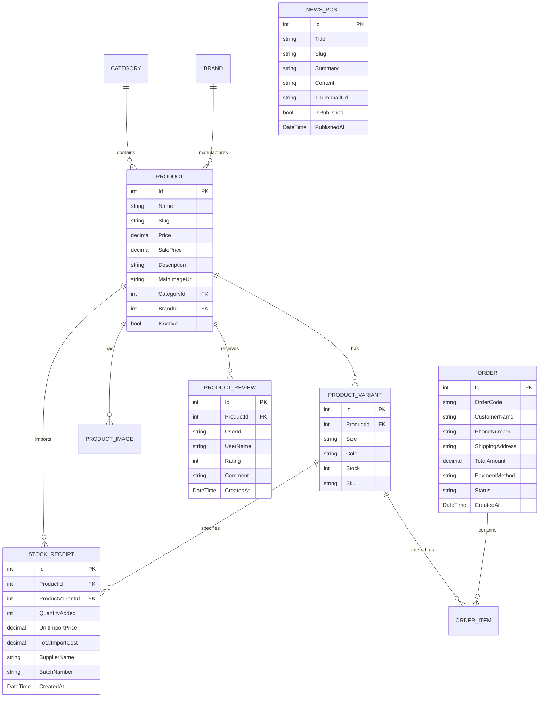

# 🏸 Tiêu Đao Badminton - Hệ Thống Bán Lẻ & Dịch Vụ Cầu Lông Chuyên Nghiệp

[](https://dotnet.microsoft.com/download/dotnet/8.0)
[](https://docs.microsoft.com/aspnet/core)
[](https://docs.microsoft.com/ef/core)
[](https://www.microsoft.com/sql-server)
[](https://getbootstrap.com/)
[](https://ckeditor.com/)

> **Tiêu Đao Badminton** là nền tảng thương mại điện tử và giải pháp quản lý chuỗi bán lẻ thiết bị thể thao (vợt, giày, quần áo, phụ kiện) kết hợp dịch vụ căng cước cầu lông chuẩn thi đấu quốc tế. Hệ thống được xây dựng trên nền tảng **ASP.NET Core 8.0 MVC**, áp dụng kiến trúc chuẩn mực, cơ chế đồng bộ kho hàng thông minh, tư vấn vợt AI và quản lý doanh thu - lãi suất thực tế.

---

## 📑 Mục Lục

1. [Tổng Quan Dự Án](#-tổng-quan-dự-án)
2. [Tính Năng Nổi Bật](#-tính-năng-nổi-bật)
   - [Phân Hệ Khách Hàng (Storefront)](#1-phân-hệ-khách-hàng-storefront)
   - [Phân Hệ Quản Trị Viên (Admin Portal)](#2-phân-hệ-quản-trị-viên-admin-portal)
3. [Công Nghệ & Thư Viện Sử Dụng](#-công-nghệ--thư-viện-sử-dụng)
4. [Cấu Trúc Thư Mục Dự Án](#-cấu-trúc-thư-mục-dự-án)
5. [Cơ Sở Dữ Liệu & Thực Thể (Database Schema)](#-cơ-sở-dữ-liệu--thực-thể-database-schema)
6. [Hướng Dẫn Cài Đặt & Chạy Ứng Dụng](#-hướng-dẫn-cài-đặt--chạy-ứng-dụng)
7. [Tài Khoản Quản Trị Mặc Định](#-tài-khoản-quản-trị-mặc-định)
8. [Quy Trình Nghiệp Vụ Đặc Biệt](#-quy-trình-nghiệp-vụ-đặc-biệt)
9. [Bản Quyền & Tác Giả](#-bản-quyền--tác-giả)

---

## 🚀 Tổng Quan Dự Án

Dự án ra đời nhằm giải quyết bài toán đặc thù của ngành kinh doanh dụng cụ cầu lông:
- **Quản lý phân loại phức tạp:** Một cây vợt hoặc đôi giày có đồng thời thông số Màu sắc và Kích cỡ/Trọng lượng (3U-G5, 4U-G5, size giày từ 38 đến 44, size áo S/M/L/XL/XXL).
- **Dịch vụ căng cước đi kèm:** Khách mua vợt thường yêu cầu căng cước máy điện tử với mức cân (kg) và kiểu đan 4 nút chuẩn Yonex.
- **Tính toán lãi suất thực tế:** Quản lý phiếu nhập kho riêng biệt, tính toán tỷ suất lợi nhuận gộp (**Profit Margin %**) và chênh lệch giá vốn (**Markup %**) dựa trên giá nhập và giá bán.
- **Tư vấn trang thiết bị chuẩn:** Công cụ trắc nghiệm phong cách đánh cầu đề xuất thiết bị phù hợp cho người chơi.

---

## ✨ Tính Năng Nổi Bật

### 1. Phân Hệ Khách Hàng (Storefront)

* **Trang Chủ Hiện Đại (Home Page):**
  - Banner Hero chuyển động, danh mục truy cập nhanh.
  - Khối Flash Sale, sản phẩm bán chạy, sản phẩm mới nhất.
  - Trưng bày thương hiệu chính hãng: *Yonex, Victor, Lining, Mizuno, Kumpoo, Kawasaki...*
  - Giới thiệu dịch vụ sân cầu, đan cước lấy ngay 15 phút.
  - Cẩm nang & tin tức kinh nghiệm mới nhất.

* **Bộ Lọc Danh Mục Chuyên Nghiệp (Product Catalog - `/Danh-Muc`):**
  - Lọc đa tiêu chí: Theo Danh mục, Thương hiệu, Khoảng giá, Tình trạng còn hàng.
  - Sắp xếp linh hoạt: Bán chạy, Giá tăng/giảm, Mới nhất, Thứ tự chữ cái.
  - Phân trang (Pagination) mượt mà.

* **Trang Chi Tiết Sản Phẩm Đột Phá (Product Detail - `/Products/Detail/{id}`):**
  - **Tách biệt Màu sắc & Kích cỡ:** Khách hàng chủ động chọn Màu sắc để mở khóa các Size tương ứng có trong kho.
  - **Liên kết kho hàng thực tế:** Hiển thị tức thì số lượng tồn kho từng màu (`Kho còn X`) và từng size (`Còn Y chiếc`), gắn mã SKU kho hàng tự động.
  - **Dịch vụ căng cước tích hợp:** Tùy chọn mức căng cước (10.5kg, 11kg, 11.5kg, 12kg...) miễn phí đan máy điện tử 4 nút chuẩn thi đấu.
  - **Hệ thống đánh giá & Review:** Đăng nhập để đánh giá sao (1-5 ⭐) và để lại nhận xét, có tổng hợp điểm trung bình và tỷ lệ phân bổ sao.
  - **Modal bảng quy đổi Size:** Hướng dẫn chọn size vợt (3U/4U/5U), size giày chuẩn mm, size trang phục thể thao.
  - **Thông số kỹ thuật (Specs Tab):** Liệt kê chi tiết chất liệu, độ cứng đũa, điểm cân bằng, xuất xứ.

* **Trợ Lý Tư Vấn Chọn Vợt Thông Minh (Racket Advisor - `/Tu-Van-Chon-Vot`):**
  - Trắc nghiệm theo 3 tiêu chí cốt lõi:
    1. *Lối đánh:* Tấn công smash uy lực, Tốc độ phản tạt, Công thủ toàn diện.
    2. *Lực cổ tay:* Mới chơi/yếu, Trung bình, Khỏe/bán chuyên.
    3. *Ngân sách dự kiến:* Dưới 1 triệu, 1-2 triệu, 2-3 triệu, Trên 3 triệu.
  - Thuật toán tự động chấm điểm và gợi ý Top 4 cây vợt tối ưu kèm lời khuyên chuyên gia.

* **Tạp Chí Cẩm Nang & Kinh Nghiệm Cầu Lông (News Magazine - `/Cam-Nang`):**
  - Giao diện báo chí hiện đại với các phân loại: Vợt, Giày, Kỹ thuật Smash, Căng cước.
  - **Mục lục bài viết tự động (TOC):** Tự động phát hiện các tiêu đề `H2`, `H3` để tạo mục lục nội dung bấm nhảy mượt mà.
  - **Tiện ích đọc bài chuyên nghiệp:** Thanh tiến trình cuộn trang (Progress Bar), công cụ tăng/giảm cỡ chữ (A-, A, A+), nút in bài viết, sao chép link, chia sẻ qua Facebook & Zalo.
  - **Tương tác cảm xúc:** Bấm bình chọn *"👍 Rất hữu ích"*, *"❤️ Lưu lại"*, *"🏸 Sẽ áp dụng ngay"*.

* **Giỏ Hàng & Thanh Toán Nhanh (Cart & Checkout):**
  - Mini cart và trang quản lý giỏ hàng lưu Session.
  - Form đặt hàng tối giản thông tin, hỗ trợ ghi chú đơn hàng.
  - Đa dạng phương thức thanh toán: COD (Tiền mặt khi nhận hàng), Chuyển khoản ngân hàng QR Code, Ví điện tử.
  - Tự động sinh mã hóa đơn định danh dạng `ORD-XXXXXX`.

* **Tra Cứu Tiến Trình Đơn Hàng (Order Tracking - `/OrderTracking`):**
  - Tra cứu nhanh theo Mã đơn hàng hoặc Số điện thoại.
  - Hiển thị Timeline trạng thái: *Chờ xử lý ➔ Đã xác nhận ➔ Đang vận chuyển ➔ Giao thành công / Đã hủy*.

* **Danh Sách Yêu Thích (Wishlist - `/Wishlist`):**
  - Lưu trữ sản phẩm yêu thích, hỗ trợ thêm nhanh vào giỏ hàng.

* **Tài Khoản Khách Hàng (Identity Account):**
  - Đăng ký, đăng nhập bảo mật, xem lịch sử đơn hàng đã mua.

---

### 2. Phân Hệ Quản Trị Viên (Admin Portal - `/Admin`)

* **Bảng Thống Kê Tổng Quan (Dashboard - `/Admin/Home`):**
  - Doanh thu bán hàng, tổng số đơn hàng mới, số lượng sản phẩm, tình trạng kho tổng.
  - Danh sách đơn hàng mới đặt cần duyệt gấp.

* **Quản Lý Sản Phẩm (Product Management - `/Admin/Products`):**
  - Thêm, sửa, xóa sản phẩm kèm bộ lọc danh mục và thương hiệu.
  - Upload ảnh trực tiếp lên máy chủ (`wwwroot/uploads/products/`).
  - Thiết lập giá bán niêm yết, giá khuyến mại giảm sốc.
  - Khởi tạo ma trận phân loại (Màu sắc, Size, SKU, Số lượng kho ban đầu).

* **Quản Lý Nhập Kho & Quản Trị Lãi Suất (`/Admin/StockReceipts`):**
  - **Phiếu Nhập Hàng Độc Lập:**
    - Ghi nhận thông tin nhà cung cấp, xuất xứ hàng hóa, mã số lô nhập.
    - Nhập theo từng biến thể cụ thể hoặc nhập đồng loạt cho toàn bộ phân loại sản phẩm.
    - Ghi nhận đơn giá nhập (giá vốn) và tự động cộng dồn số lượng vào kho hàng thực tế.
  - **Báo Cáo Đối Chiếu Giá & Lãi Suất (Profit Report):**
    - Bảng thống kê đối chiếu giữa Giá nhập (Giá vốn) và Giá bán lẻ.
    - Tính toán tự động:
      $$\text{Profit Margin (\%)} = \frac{\text{Giá bán} - \text{Giá nhập}}{\text{Giá bán}} \times 100\%$$
      $$\text{Markup (\%)} = \frac{\text{Giá bán} - \text{Giá nhập}}{\text{Giá nhập}} \times 100\%$$
    - Phân loại mức sinh lời trực quan bằng Badge: *Siêu lợi nhuận (>=45%), Sinh lời tốt (30-45%), Trung bình (20-30%), Biên độ thấp (<20%)*.
    - Hỗ trợ phân trang, tìm kiếm theo tên/thương hiệu và sắp xếp linh hoạt theo Doanh thu / Lợi nhuận gộp / Tỷ suất %.

* **Biên Tập Cẩm Nang Với CKEditor 5 (News Management - `/Admin/News`):**
  - Tích hợp bộ soạn thảo **CKEditor 5 Classic** chuẩn hóa tiếng Việt.
  - Hỗ trợ đầy đủ: Định dạng văn bản, phân cấp tiêu đề `H2`, `H3`, `H4`, chèn bảng thông số kỹ thuật, khối trích dẫn chuyên gia, nhúng video YouTube.
  - **API Upload Ảnh Riêng (`/Admin/News/UploadEditorImage`):** Cho phép kéo thả ảnh hoặc dán ảnh trực tiếp từ clipboard (`Ctrl+V`), tự động lưu vào máy chủ và chèn vào nội dung bài viết.
  - Tự động sinh đường dẫn thân thiện (SEO Slug) từ tiêu đề tiếng Việt.

* **Quản Lý Đơn Hàng (Order Management - `/Admin/Orders`):**
  - Theo dõi danh sách đơn hàng, xem chi tiết từng mặt hàng và yêu cầu số kg đan cước của khách.
  - Cập nhật trạng thái đơn hàng (Đang xử lý, Đang giao, Hoàn tất, Hủy đơn).

* **Quản Lý Danh Mục & Thương Hiệu (Categories & Brands):**
  - Quản lý danh mục sản phẩm (Vợt, Giày, Quần áo, Phụ kiện, Balo...).
  - Quản lý các hãng thể thao hàng đầu thế giới.

* **Quản Lý Người Dùng & Phân Quyền (User Management - `/Admin/Accounts`):**
  - Quản lý danh sách tài khoản, phân quyền Role: `Admin`, `Staff`, `Customer`.
  - Khóa / mở khóa tài khoản, đặt lại mật khẩu an toàn.

---

## 🛠 Công Nghệ & Thư Viện Sử Dụng

| Hạng mục | Công nghệ / Thư viện | Ghi chú |
| :--- | :--- | :--- |
| **Framework nền tảng** | ASP.NET Core 8.0 MVC | C# .NET 8.0 (LTS) |
| **ORM & Database** | Entity Framework Core 8.0 | Code-First Migrations, SQL Server / LocalDB |
| **Bảo mật & Xác thực** | ASP.NET Core Identity | Phân quyền Role-based, mã hóa mật khẩu PBKDF2 |
| **Giao diện (Frontend)** | Razor Views + Bootstrap 5.3 + Custom CSS | Responsive đa thiết bị, Design System hiện đại |
| **Icons & Font** | Bootstrap Icons, Font Awesome, Google Fonts | Inter, Outfit, Roboto |
| **Trình soạn thảo WYSIWYG** | CKEditor 5 Classic (Gói Tiếng Việt) | Kèm Custom Upload Adapter tải ảnh máy chủ |
| **Session & Cache** | ASP.NET Core Distributed Memory Cache & Session | Quản lý giỏ hàng, bộ lọc |
| **Xử lý chuỗi & Unicode** | Regular Expressions, Unicode NFC Normalization | Xử lý Slug tiếng Việt và so sánh phân loại kho |

---

## 📁 Cấu Trúc Thư Mục Dự Án

```plaintext
tieudaobadminton/
├── Areas/
│   └── Admin/                              # Phân hệ quản trị (Admin Portal)
│       ├── Controllers/                    # Controllers quản trị
│       │   ├── AccountsController.cs       # Quản lý người dùng & phân quyền
│       │   ├── BrandsController.cs         # Quản lý thương hiệu
│       │   ├── CategoriesController.cs     # Quản lý danh mục
│       │   ├── ContactsController.cs       # Quản lý tin nhắn liên hệ
│       │   ├── HomeController.cs           # Dashboard thống kê tổng quan
│       │   ├── NewsController.cs           # Quản lý cẩm nang & API upload ảnh CKEditor
│       │   ├── OrdersController.cs         # Quản lý đơn hàng
│       │   ├── ProductsController.cs       # Quản lý sản phẩm & biến thể
│       │   └── StockReceiptsController.cs  # Quản lý phiếu nhập kho & báo cáo lãi suất
│       ├── ViewModels/                     # ViewModels dành riêng cho Admin
│       └── Views/                          # Giao diện quản trị Admin
├── Controllers/                            # Controllers phân hệ khách hàng (Storefront)
│   ├── AccountController.cs                # Đăng ký, đăng nhập, hồ sơ
│   ├── CartController.cs                   # Giỏ hàng & thao tác thêm/sửa/xóa
│   ├── CatalogController.cs                # Danh mục sản phẩm & bộ lọc đa chiều
│   ├── CheckoutController.cs               # Đặt hàng & thanh toán
│   ├── ContactController.cs                # Trang liên hệ
│   ├── GuideController.cs                  # Hướng dẫn chọn size
│   ├── HomeController.cs                   # Trang chủ & thông tin cửa hàng
│   ├── NewsController.cs                   # Tạp chí cẩm nang & kinh nghiệm thi đấu
│   ├── OrderTrackingController.cs          # Tra cứu đơn hàng trực tuyến
│   ├── ProductsController.cs               # Chi tiết sản phẩm, biến thể kho, review sao
│   ├── RacketAdvisorController.cs          # Trợ lý tư vấn vợt thông minh (AI Racket Advisor)
│   ├── ServicesController.cs               # Dịch vụ căng cước, sửa chữa vợt
│   └── WishlistController.cs               # Danh sách sản phẩm yêu thích
├── Data/                                   # Cấu hình dữ liệu & Entity Framework Core
│   ├── ApplicationDbContext.cs             # DbContext chính của ứng dụng
│   ├── DbSeeder.cs                         # Seed dữ liệu mẫu ban đầu (Sản phẩm, danh mục, kho)
│   └── IdentitySeeder.cs                   # Seed tài khoản Admin & vai trò mặc định
├── Migrations/                             # Lịch sử migrations của EF Core
├── Models/                                 # Các thực thể dữ liệu (Entities)
│   ├── Brand.cs                            # Thương hiệu (Yonex, Victor, Lining...)
│   ├── Category.cs                         # Danh mục sản phẩm
│   ├── ContactMessage.cs                   # Tin nhắn liên hệ từ khách
│   ├── NewsPost.cs                         # Bài viết cẩm nang & tin tức
│   ├── Order.cs & OrderItem.cs             # Đơn hàng và chi tiết sản phẩm đơn hàng
│   ├── Product.cs                          # Sản phẩm chính
│   ├── ProductImage.cs                     # Bộ sưu tập ảnh sản phẩm
│   ├── ProductReview.cs                    # Đánh giá & xếp hạng sao từ khách hàng
│   ├── ProductVariant.cs                   # Phân loại kho (Màu sắc, Size, Tồn kho, SKU)
│   └── StockReceipt.cs                     # Phiếu nhập hàng vào kho (Giá vốn, Nhà cung cấp)
├── ViewModels/                             # ViewModels truyền dữ liệu cho Views
├── Views/                                  # Giao diện khách hàng (Razor Views)
│   ├── Account/                            # Đăng nhập, đăng ký
│   ├── Cart/                               # Giỏ hàng
│   ├── Catalog/                            # Danh mục & bộ lọc
│   ├── Checkout/                           # Thanh toán
│   ├── Home/                               # Trang chủ
│   ├── News/                               # Danh sách & chi tiết cẩm nang
│   ├── OrderTracking/                      # Tra cứu đơn hàng
│   ├── Products/                           # Chi tiết sản phẩm
│   ├── RacketAdvisor/                      # Tư vấn chọn vợt
│   └── Shared/                             # Layout chung (_Layout, _Header, _Footer...)
├── wwwroot/                                # Tệp tĩnh công khai
│   ├── css/                                # Tệp CSS tùy chỉnh (site.css)
│   ├── js/                                 # Javascript tương tác
│   ├── img/                                # Hình ảnh banners, sản phẩm, tin tức
│   └── uploads/                            # Thư mục lưu file tải lên từ máy tính (ảnh sản phẩm, bài viết)
├── appsettings.json                        # Cấu hình chuỗi kết nối và ứng dụng
├── Program.cs                              # Điểm khởi chạy ứng dụng (DI, Pipeline, Middleware)
└── tieudaobadminton.csproj                 # Tệp cấu hình dự án .NET
```

---

## 🗄 Cơ Sở Dữ Liệu & Thực Thể (Database Schema)



---

## ⚙️ Hướng Dẫn Cài Đặt & Chạy Ứng Dụng

### 1. Yêu Cầu Môi Trường (Prerequisites)
- [.NET 8.0 SDK](https://dotnet.microsoft.com/download/dotnet/8.0) trở lên.
- **SQL Server** (LocalDB đi kèm Visual Studio, SQL Server Express, hoặc SQL Server bản chuẩn).
- Trình duyệt hiện đại (Chrome, Edge, Firefox).

### 2. Cấu Hình Chuỗi Kết Nối Cơ Sở Dữ Liệu
Mở tệp `appsettings.json` tại thư mục gốc của dự án và kiểm tra chuỗi kết nối:
```json
{
  "ConnectionStrings": {
    "DefaultConnection": "Server=(localdb)\\MSSQLLocalDB;Database=BadmintonShop;Trusted_Connection=True;TrustServerCertificate=True;"
  }
}
```
> *Lưu ý: Nếu sử dụng SQL Server có tài khoản và mật khẩu, hãy cập nhật lại `User ID` và `Password` cho phù hợp.*

### 3. Cập Nhật Cơ Sở Dữ Liệu (Migrations)
Mở cửa sổ dòng lệnh (Terminal / PowerShell) tại thư mục chứa dự án và chạy:
```powershell
dotnet restore
dotnet ef database update
```
*(Nếu chưa cài công cụ EF CLI toàn cục, chạy: `dotnet tool install --global dotnet-ef`)*

### 4. Khởi Chạy Ứng Dụng
```powershell
dotnet run
```
Sau khi ứng dụng khởi động thành công, mở trình duyệt và truy cập:
- **Trang chủ Khách hàng:** `https://localhost:7085` (hoặc cổng HTTP hiển thị trên màn hình console).
- **Trang Quản trị Admin:** `https://localhost:7085/Admin`

---

## 🔑 Tài Khoản Quản Trị Mặc Định

Hệ thống đã tích hợp sẵn cơ chế **Tự động Seed dữ liệu** khi khởi chạy lần đầu tiên:

| Vai trò (Role) | Tài khoản (Email) | Mật khẩu (Password) | Quyền hạn |
| :--- | :--- | :--- | :--- |
| **Quản trị viên (Admin)** | `admin@shop.com` | `Admin@12345` | Toàn quyền quản trị hệ thống, kho hàng, tài khoản, bài viết |

---

## 💡 Quy Trình Nghiệp Vụ Đặc Biệt

### 1. Cơ Chế Lọc & Hiển Thị Phân Loại Kho Tự Động (Variant Matrix)
- Dữ liệu màu sắc và kích cỡ được trích xuất hoàn toàn tự động từ bảng `ProductVariants`.
- Khi khách hàng click chọn Màu sắc (Ví dụ: `Đen`), hệ thống Javascript sử dụng chuẩn mã **Unicode NFC** tra cứu tức thời ma trận biến thể:
  - Chỉ hiển thị các kích cỡ thực sự có trong kho hàng ứng với màu đó (`tile.style.display = 'flex'`).
  - Gắn nhãn số lượng chính xác (`Còn X chiếc`) hoặc `Hết hàng`.
  - Cập nhật huy hiệu trạng thái và mã SKU quản lý kho.

### 2. Quản Trị Nhập Hàng & Phân Tích Lãi Suất (Stock Receipts & Profit)
- Khi nhập hàng vào kho (`/Admin/StockReceipts/Create`), số lượng trong kho của từng phân loại sẽ được tự động cộng dồn lũy kế.
- Tại bảng báo cáo lãi suất (`/Admin/StockReceipts/ProfitReport`):
  - Hệ thống lấy Giá vốn bình quân từ các phiếu nhập đối chiếu với Giá bán niêm yết/khuyến mãi của sản phẩm.
  - Phân tích chi tiết phần trăm **Margin** và **Markup** giúp chủ cửa hàng đưa ra quyết định nhập hàng và định giá chính xác.

### 3. Soạn Thảo Cẩm Nang Với CKEditor 5
- Khung nội dung chi tiết bài viết tại Admin được tích hợp **CKEditor 5 Classic** hỗ trợ đầy đủ các thao tác trực quan.
- Ảnh dán từ Clipboard hoặc kéo thả sẽ được gửi ngầm qua API `/Admin/News/UploadEditorImage`, lưu vào thư mục `wwwroot/uploads/news/` và lập tức nhúng vào khung soạn thảo.
- Ngoài trang người dùng (`/Cam-Nang/{id}`), hệ thống tự động quét các thẻ `<h2>`, `<h3>` của bài viết để sinh mục lục đọc nhanh (Table of Contents).

---

## 👨‍💻 Bản Quyền & Tác Giả

- **Dự Án:** Đồ Án Môn Học - Hệ Thống Bán Lẻ & Quản Lý Dụng Cụ Cầu Lông Tiêu Đao
- **Nền tảng phát triển:** ASP.NET Core 8.0 MVC
- **Năm thực hiện:** 2026

*Mọi thắc mắc hoặc yêu cầu hỗ trợ kỹ thuật, vui lòng liên hệ đội ngũ quản trị qua email hoặc hotline được cấu hình trong hệ thống.*
